<div align="center">

# Round

### Bitcoin-secured savings circles on Mezo

**Save in dollars with people you don't fully trust, without selling your Bitcoin.**

[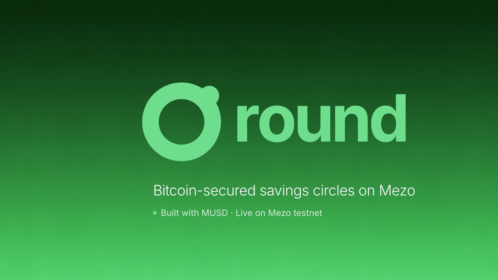](https://youtu.be/Gs2QBHjdmqo)

[▶ Watch the demo on YouTube (68 s)](https://youtu.be/Gs2QBHjdmqo) · [Contract on Mezo testnet](https://explorer.test.mezo.org/address/0xfaf2003837bb3db7ae63cf1a4a26d0dd9790254e) · [Verified source (Sourcify)](https://repo.sourcify.dev/31611/0xfaF2003837bB3Db7ae63CF1A4a26d0DD9790254e)

</div>

---

## The problem

A savings circle (a ROSCA, called *ajo* or *esusu* in Nigeria, *susu* in Ghana and the Caribbean, *tandas* in Latin America,
*chit funds* in India, *hui* in China) is simple: a small group pays the same amount every round, and one member takes the
whole pot each round. Savings circles are widely used across Africa, Latin America and Asia.

They have one fatal flaw. **Someone takes the pot early, then stops paying.** The members who haven't been paid yet lose
money, so circles only work between people who already trust each other completely.

## The solution

Round puts the circle on Mezo and replaces trust with collateral:

- Everyone saves and gets paid in **MUSD**, Mezo's Bitcoin-backed dollar.
- To join, each member locks **BTC** worth 150% of the most they could ever owe, sized live by **Mezo's PriceFeed**.
- If a member misses a payment, the contract takes the missed amount **plus a 10% penalty** from their BTC. The round's
  recipient is paid in full, and the penalty is shared with the members who kept their promise.
- There's no owner, no admin key and no keeper. Anyone can settle a round when it's due.

**Your Bitcoin keeps the promise, so nobody has to.**

---

## Deployment

| | |
|---|---|
| Network | **Mezo testnet (matsnet)**, chain ID `31611` |
| Round contract | [`0xfaf2003837bb3db7ae63cf1a4a26d0dd9790254e`](https://explorer.test.mezo.org/address/0xfaf2003837bb3db7ae63cf1a4a26d0dd9790254e) (deploy block `16329740`) |
| Source verification | [Sourcify: exact match](https://repo.sourcify.dev/31611/0xfaF2003837bB3Db7ae63CF1A4a26d0DD9790254e) (creation and runtime bytecode) |
| Demo circle | Circle **#1**: 4 people · 100 MUSD per round · 5-minute rounds · 60 s grace · 150% collateral · 10% penalty |
| MUSD | [`0x118917a40FAF1CD7a13dB0Ef56C86De7973Ac503`](https://explorer.test.mezo.org/address/0x118917a40FAF1CD7a13dB0Ef56C86De7973Ac503) |
| PriceFeed | [`0x86bCF0841622a5dAC14A313a15f96A95421b9366`](https://explorer.test.mezo.org/address/0x86bCF0841622a5dAC14A313a15f96A95421b9366) |

---

## Screenshots

| Landing page | A circle on testnet (live data) |
|---|---|
| 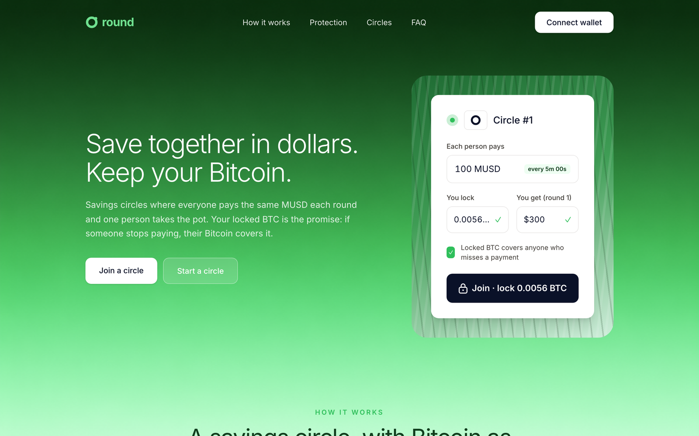 | 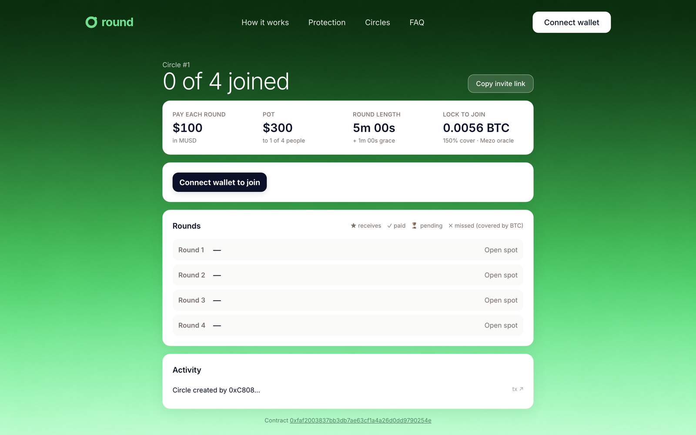 |
| **Start a circle** (collateral priced live by Mezo's oracle) | **Mobile** |
| 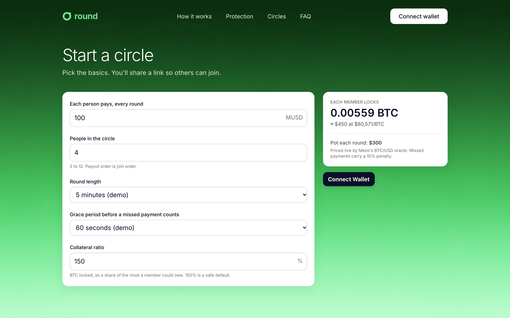 | 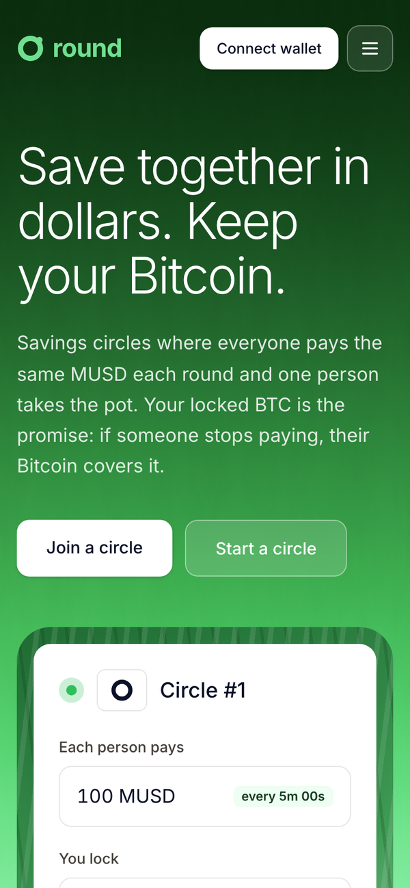 |

### The flow, captured from a full run of the contract

One button changes with the circle's state: **Join → Pay → Settle → Withdraw**.

| Step | What the member sees |
|---|---|
| **Join**: lock BTC sized by Mezo's PriceFeed |  |
| **Pay**: one EIP-2612 signature, no separate approval |  |
| **Settle**: anyone can trigger it; a missed payment is covered from BTC |  |

**A default, covered.** Member 1 took the pot in round 1 and skipped round 2. The contract took 0.001375 BTC from their
collateral and Member 2 was still paid in full:

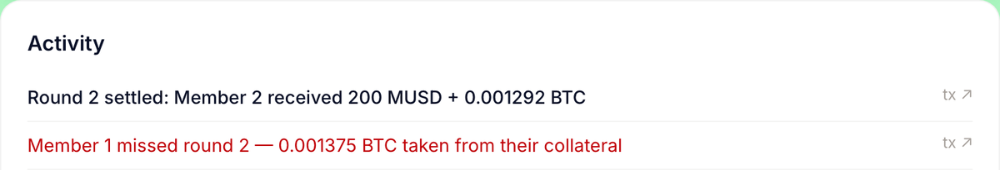

| Round timeline after the default | The defaulter's own view |
|---|---|
| 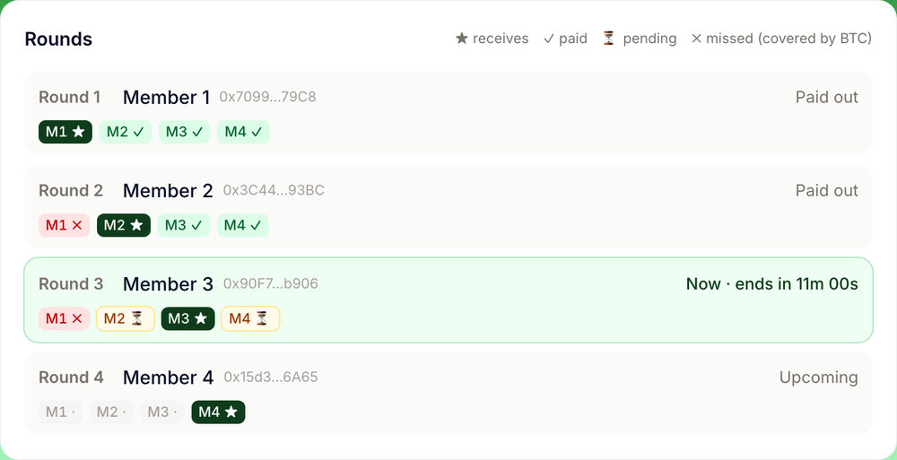 | 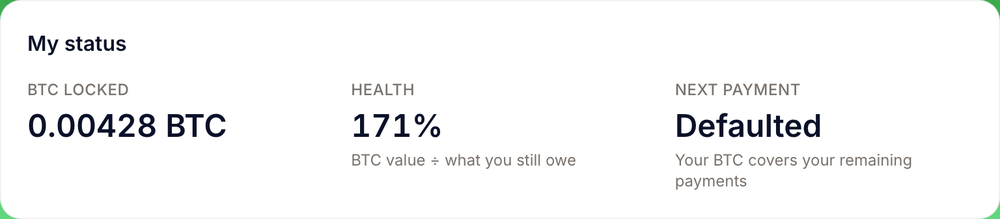 |

---

## How it works

### Architecture

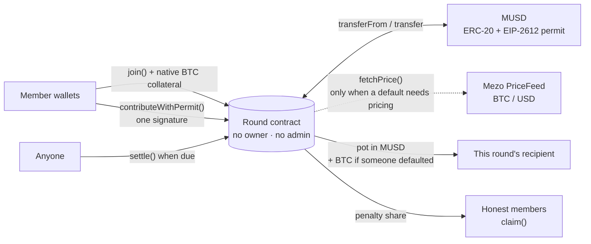

### The life of a circle

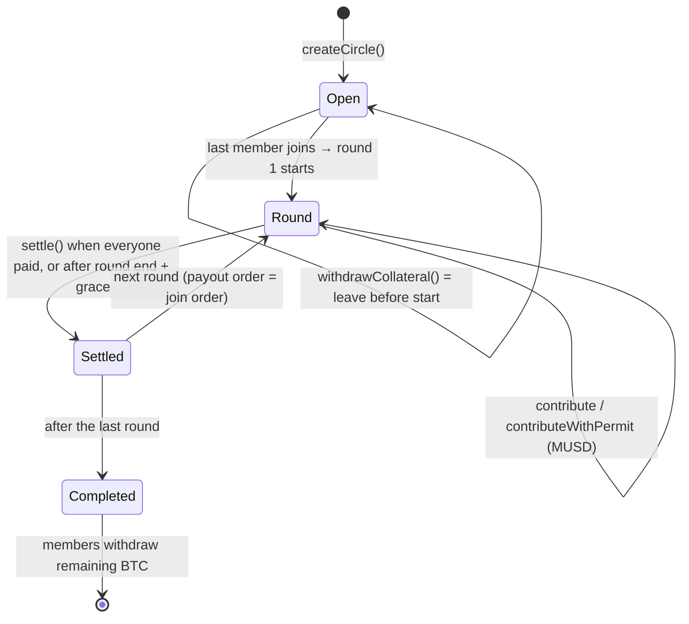

### What happens when someone stops paying

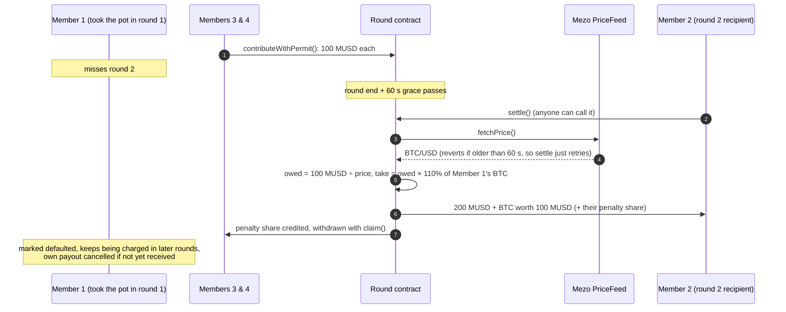

### A worked example with real numbers

From the end-to-end run shown in the demo (4 people, 100 MUSD per round, BTC at $80,000):

| | Value |
|---|---|
| Max obligation per member | 100 MUSD × 3 other rounds = **$300** |
| Collateral at 150% | $450 ÷ $80,000 = **0.005625 BTC** (the app adds a 0.5% price buffer, so 0.00565 BTC is locked) |
| Member 1 misses round 2: BTC owed | 100 ÷ 80,000 = **0.00125 BTC** |
| Taken, with the 10% penalty | **0.001375 BTC** |
| Member 2 receives | **200 MUSD + 0.001292 BTC** (the missed payment plus a third of the penalty) |
| Members 3 and 4 | 0.0000417 BTC penalty share each, via `claim()` |
| Member 1's collateral left | 0.004275 BTC, still charged for rounds 3 and 4 |

If BTC crashes so far that a defaulter's collateral can't cover a payment, the contract pays out what's there and emits
`Shortfall(id, member, usdUncovered)`. The app shows it plainly rather than hiding it.

---

## Mezo integration

| Mezo primitive | How Round uses it | Where |
|---|---|---|
| **MUSD** | Every contribution and every payout | [`Round.sol`](contracts/src/Round.sol): `contribute`, `settle` |
| **MUSD `permit` (EIP-2612)** | Pay in one signature plus one transaction. Domain verified on testnet: name `Mezo USD`, version `1` | `contributeWithPermit`, [`ActionPanel.tsx`](web/components/ActionPanel.tsx) |
| **Native BTC** | Collateral, locked with `msg.value`, paid out with `call{value:}` | `join`, `topUpCollateral`, `_sendBTC` |
| **PriceFeed** | Sizes collateral and values defaults (1e18 scale). Read **only** when a default needs pricing, so a stale oracle never blocks a clean round | `_requiredCollateral`, `_coverDefaults`, `health` |

Round gives MUSD a new, recurring job: every circle needs each member to hold MUSD every round, and every circle keeps BTC
locked on Mezo for its whole life.

---

## Contract

One contract, [`contracts/src/Round.sol`](contracts/src/Round.sol) (368 lines), holds every circle. Solidity 0.8.24,
`evm_version = london`, OpenZeppelin 5.0.2.

**External functions:** `createCircle` · `join` · `contribute` · `contributeWithPermit` · `settle` · `topUpCollateral` ·
`withdrawCollateral` · `claim` · views `requiredCollateral` · `health` · `roundInfo` · `getMembers` · `remainingObligations`

**Events:** `CircleCreated` · `Joined` · `CircleStarted` · `Contributed` · `RoundSettled` · `Defaulted` · `Shortfall` ·
`CollateralToppedUp` · `CollateralWithdrawn` · `CircleCompleted` · `Claimed`

**Security properties:**
- No owner, no upgrades, no pause. `musd` and `priceFeed` are immutable.
- `ReentrancyGuard` on every function that moves value, checks-effects-interactions throughout, `SafeERC20` for MUSD.
- A recipient that rejects BTC can't freeze a circle: failed pushes are credited to `pendingWithdrawals` and withdrawn with `claim()`.
- Penalty shares are credited, not pushed in a loop, so `settle` makes no unbounded external calls.
- `settle` is permissionless and can't double-pay. A contribution only counts for the current round, once, from a member who owes it.
- Collateral requirements round **up**, so locking exactly `requiredCollateral` is never a wei short of the ratio.
- A member can leave before the circle starts, so BTC is never stuck in a circle that never fills.

The full list of design decisions, and the Mezo facts verified on testnet, are in [NOTES.md](NOTES.md).

---

## Testing

```bash
cd contracts
forge test                                                                   # unit + fuzz + invariant
forge test --match-contract RoundFork --fork-url https://rpc.test.mezo.org   # real MUSD + native BTC on forked testnet state
forge coverage --report summary --no-match-coverage "test|script"
slither . --filter-paths "lib|test"
```

| | Result |
|---|---|
| Tests | **20 passing**: 16 unit · 2 fuzz (512 runs each) · 2 invariants (8,192 calls each), plus 1 fork test |
| Coverage of `Round.sol` | **98.9% lines** · 97.3% statements · 90.7% branches · 95.5% functions |
| Slither | **0 high · 0 medium** |

The tests cover:
- the happy path, and a default after payout
- a default before payout (that member's payout is cancelled)
- a 60% BTC crash (shortfall reported, no stuck funds)
- a stale oracle (it blocks only a default, which settles once the price is fresh)
- collateral checks, and a real EIP-2612 signature
- double settle, double payment and wrong-round payments
- a recipient that rejects BTC, leaving before the start, and early withdrawal after the final payment
- fuzzed full circles (2–12 members, random prices and default patterns)

**Invariants:** MUSD held = contributions not yet paid out · BTC held = all collateral + all pending withdrawals.

---

## Run it locally

**Frontend** (Next.js 15 · wagmi · viem · RainbowKit · Tailwind):

```bash
cd web
cp .env.example .env.local     # NEXT_PUBLIC_ROUND_ADDRESS=0xfaf2003837bb3db7ae63cf1a4a26d0dd9790254e
npm install
npm run dev                    # http://localhost:3000
```

Get test BTC at <https://faucet.test.mezo.org> and test MUSD at <https://testnet.mezo.org>. When you connect, your wallet is
asked to add Mezo Testnet (chain 31611) automatically.

**Contracts** (Foundry):

```bash
cd contracts
# .env holds TESTNET-ONLY keys: DEPLOYER_KEY and MEMBER1_KEY..MEMBER4_KEY (never commit it)
./script/testnet.sh deploy     # deploy + verify Round, create demo circle #1
./script/testnet.sh borrow     # open a MUSD trove from the deployer (1,800 MUSD minimum)
./script/testnet.sh fund       # send demo members MUSD (and BTC)
./script/testnet.sh balances
```

---

## Repository

```
contracts/        Foundry project
  src/Round.sol             the contract
  test/                     unit, fuzz, invariant and fork tests (+ mocks)
  script/                   Deploy, CreateDemoCircle, testnet.sh
web/              Next.js frontend: landing page, circles, create, circle page
video/            the demo film (round-demo.mp4) and its HyperFrames source
docs/screenshots/ images used in this README
NOTES.md          verified Mezo facts and design decisions
```

## Roadmap (Wave 2)

- **Telegram bot** (Track 2, Access & Distribution): create and join circles, payment reminders, settle alerts
- **Borrow your contribution**: open a Mezo trove and join a circle in one flow
- Put idle pot MUSD in the Stability Pool between payments
- Reputation: completed circles lower the required collateral ratio
- Random or bid-based payout order, and a protocol fee on payouts
- Mainnet launch with low caps

## Credits

- Built for the **Mezo Buildathon** on AKINDO.
- Demo music: "Soft Corporate" by MusicLFiles, licensed [CC BY 4.0](https://creativecommons.org/licenses/by/4.0/).
- Narration voice: HeyGen. Sound effects: the HyperFrames bundled library.
- Contract code is MIT-licensed (SPDX headers).

> Testnet only. Test BTC and test MUSD have no value.
